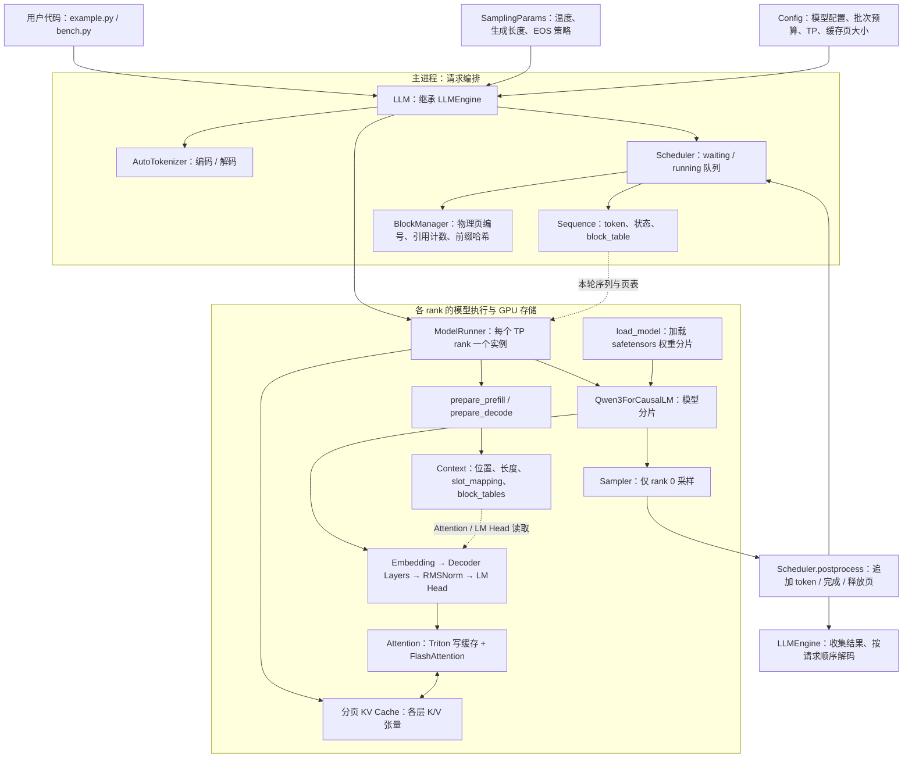
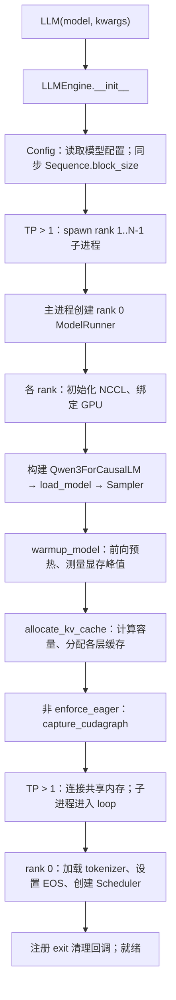
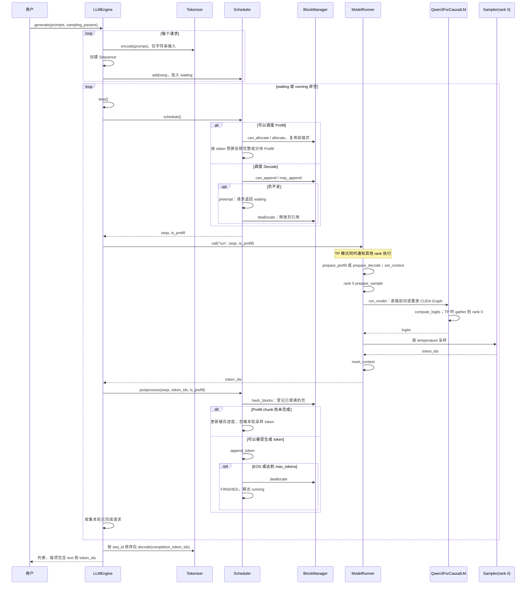
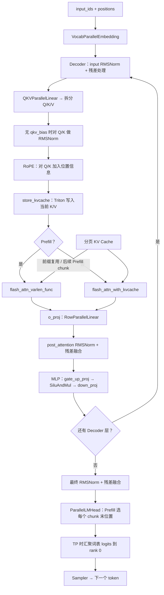
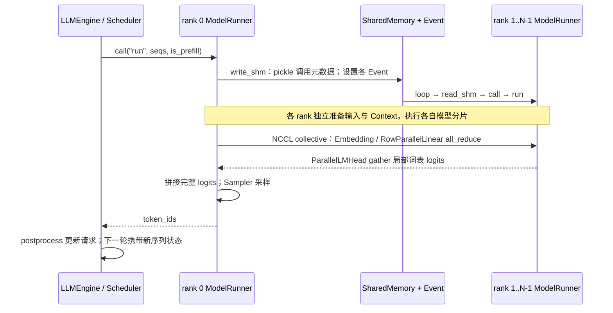

# Nano-vLLM 架构与调用链路

依据当前工作区源码整理。图中方法名对应实际实现；本文描述离线批量推理流程。

## 1. 整体架构

- `BlockManager` 管理 CPU 上的页元数据，`ModelRunner.allocate_kv_cache()` 分配 GPU 张量并将每层缓存注入 `Attention`。
- `Sequence.block_table` 把请求的逻辑页映射到物理页；`slot_mapping` 指定本轮新 K/V 的写入槽位。
- `Context` 是每个进程的全局上下文，由执行器设置，Attention 与 LM Head 隐式读取。
- 当前执行器直接构造 `Qwen3ForCausalLM`。

## 2. 初始化调用链

子进程与主进程的模型初始化并行进行；图中汇总了每个 rank 都会执行的步骤。Scheduler 在 rank 0 完成缓存分配后创建，因此能获取实际 KV 页数量。

## 3. generate 端到端调用链

每轮 batch 只包含 Prefill 或 Decode；Prefill 优先。只有本轮第一个 Prefill 请求允许被拆分，后续请求必须完整放入剩余预算。Prefill 最后一个 chunk 产生第一个有效生成 token，Decode 此后每轮为每条选中序列生成一个 token。

## 4. 模型与 Attention 内部链路

初始化 warmup 尚未分配缓存时跳过 `store_kvcache`。无历史缓存的 Prefill 直接使用本轮 K/V；有历史缓存时通过 block table 读取缓存。未完成 chunk 的末位置 logits 仍会被采样，但调度器丢弃该 token。

`run_model()` 在 Prefill、`enforce_eager=True` 或 Decode batch 大于 512 时走直接前向；其余 Decode 走 CUDA Graph。图捕获覆盖模型主干，`compute_logits()` 和采样在 replay 之后执行。`enforce_eager` 不会关闭代码中独立的 `torch.compile` 装饰器。

## 5. 多 GPU 张量并行链路

共享内存传递方法名和请求元数据；GPU 张量通信通过 NCCL 完成。调度与采样集中在 rank 0，其余 rank 参与模型计算。每个 rank 保存自己 KV heads 对应的缓存分片。

## 源码索引

| 职责 | 文件 |
| --- | --- |
| 对外入口与生成循环 | [llm.py](../nanovllm/llm.py)、[llm_engine.py](../nanovllm/engine/llm_engine.py) |
| 调度、抢占、请求状态 | [scheduler.py](../nanovllm/engine/scheduler.py)、[sequence.py](../nanovllm/engine/sequence.py) |
| 缓存页分配与前缀复用 | [block_manager.py](../nanovllm/engine/block_manager.py) |
| 输入准备、GPU 缓存、CUDA Graph、TP 进程通信 | [model_runner.py](../nanovllm/engine/model_runner.py) |
| Qwen3 模型结构 | [qwen3.py](../nanovllm/models/qwen3.py) |
| Attention 与缓存写入 | [attention.py](../nanovllm/layers/attention.py) |
| 并行线性层、Embedding、输出头 | [linear.py](../nanovllm/layers/linear.py)、[embed_head.py](../nanovllm/layers/embed_head.py) |
| 采样与隐式上下文 | [sampler.py](../nanovllm/layers/sampler.py)、[context.py](../nanovllm/utils/context.py) |
